<p>
<picture>
  <source media="(prefers-reduced-motion: reduce) and (prefers-color-scheme: dark)" srcset="assets/profile/header-static-dark.svg">
  <source media="(prefers-reduced-motion: reduce) and (prefers-color-scheme: light)" srcset="assets/profile/header-static-light.svg">
  <source media="(prefers-color-scheme: dark)" srcset="assets/profile/header-dark.svg">
  
</picture>
</p>

<details open>
<summary><strong><code>profile.py</code></strong></summary>
<br>

```python
name = "Ioannis Vlachos"
location = "Sydney, NSW, Australia"
study = "Incoming MPDBS Student"
institution = "UNSW Business School"

field = "asset pricing"
focus = "derivatives"
interests = [
    "contingent pricing",
    "volatility modelling and forecasting",
    "machine learning",
    "quantitative methods in finance",
]
```

</details>

<br>

<details open>
<summary><strong><code>research.md</code></strong></summary>
<br>

[Explore my research on my website →](https://ioannisvlachos.com/research/)

</details>

---

<details open>
<summary><strong><code>elsewhere.md</code></strong></summary>
<br>

<p align="center">
  <a href="https://ioannisvlachos.com/">
    <picture>
      <source media="(prefers-color-scheme: dark)" srcset="assets/profile/contact-website-dark.svg">
      <source media="(prefers-color-scheme: light)" srcset="assets/profile/contact-website-light.svg">
      
    </picture>
  </a>
  <a href="https://ioannisvlachos.com/cv/">
    <picture>
      <source media="(prefers-color-scheme: dark)" srcset="assets/profile/contact-cv-dark.svg">
      <source media="(prefers-color-scheme: light)" srcset="assets/profile/contact-cv-light.svg">
      
    </picture>
  </a>
  <br>
  <a href="https://orcid.org/0009-0003-1216-2488">
    <picture>
      <source media="(prefers-color-scheme: dark)" srcset="assets/profile/contact-orcid-dark.svg">
      <source media="(prefers-color-scheme: light)" srcset="assets/profile/contact-orcid-light.svg">
      
    </picture>
  </a>
  <a href="https://papers.ssrn.com/sol3/cf_dev/AbsByAuth.cfm?per_id=13292568">
    <picture>
      <source media="(prefers-color-scheme: dark)" srcset="assets/profile/contact-ssrn-dark.svg">
      <source media="(prefers-color-scheme: light)" srcset="assets/profile/contact-ssrn-light.svg">
      
    </picture>
  </a>
  <a href="https://www.linkedin.com/in/vlachosii">
    <picture>
      <source media="(prefers-color-scheme: dark)" srcset="assets/profile/contact-linkedin-dark.svg">
      <source media="(prefers-color-scheme: light)" srcset="assets/profile/contact-linkedin-light.svg">
      
    </picture>
  </a>
</p>

</details>
