<p>
<picture>
  <source media="(prefers-reduced-motion: reduce) and (prefers-color-scheme: dark)" srcset="assets/profile/terminal-static-dark.svg">
  <source media="(prefers-reduced-motion: reduce) and (prefers-color-scheme: light)" srcset="assets/profile/terminal-static-light.svg">
  <source media="(prefers-color-scheme: dark)" srcset="assets/profile/terminal-dark.svg">
  
</picture>
</p>

<details open>
<summary><strong><code>profile.py</code></strong></summary>
<br>

```python
name = "Ioannis Vlachos"
location = "Melbourne, Australia"
study = "Honours"
institution = "Monash Business School"

research = {
    "field": "asset pricing",
    "interests": [
        "contingent pricing",
        "financial econometrics, forecasting and simulation",
        "information and market efficiency",
        "financial machine learning",
    ],
    "focus": [
        "risk management",
        "volatility derivatives",
        "volatility modelling and forecasting",
    ],
}
```

</details>

<br>

<details open>
<summary><strong><code>research.md</code></strong></summary>
<br>

[Explore my research on my website →](https://ioannisvlachos.com/research/)

</details>

---

<details open>
<summary><strong><code>contact.md</code></strong></summary>
<br>

<p align="center">
  <a href="https://ioannisvlachos.com/">
    <picture>
      <source media="(prefers-color-scheme: dark)" srcset="assets/profile/contact-website-dark.svg">
      <source media="(prefers-color-scheme: light)" srcset="assets/profile/contact-website-light.svg">
      
    </picture>
  </a>
  <a href="https://orcid.org/0009-0003-1216-2488">
    <picture>
      <source media="(prefers-color-scheme: dark)" srcset="assets/profile/contact-orcid-dark.svg">
      <source media="(prefers-color-scheme: light)" srcset="assets/profile/contact-orcid-light.svg">
      
    </picture>
  </a>
  <a href="https://papers.ssrn.com/sol3/cf_dev/AbsByAuth.cfm?per_id=13292568">
    <picture>
      <source media="(prefers-color-scheme: dark)" srcset="assets/profile/contact-ssrn-dark.svg">
      <source media="(prefers-color-scheme: light)" srcset="assets/profile/contact-ssrn-light.svg">
      
    </picture>
  </a>
</p>

</details>
